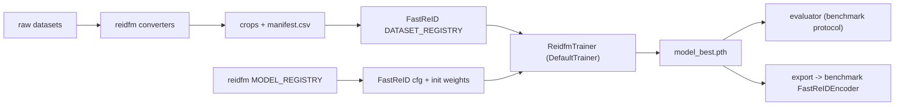

# Person-Re-ID Foundational Model (`reidfm`)

Fine-tune one **general** person-ReID encoder on a pool of datasets, instead of one model per
dataset. The benchmark (`Person-ReID-BenchMark`) showed why: FastReID SBS models reach ~96
Rank-1 in-domain but fall to 7-21 Rank-1 on MSMT17; only the multi-source OSNet-AIN model
transferred well.

- **Starting points:** FastReID `msmt_sbs_R50-ibn` / `msmt_sbs_R101-ibn`, and the same recipe
  from an ImageNet R50-IBN as a control.
- **Training:** FastReID's own `DefaultTrainer` + SBS recipe (cloned at a pinned commit, never
  edited). `reidfm` only plugs datasets, a domain-balanced sampler, and Kaggle-safe hooks into it.
- **Evaluation:** the benchmark protocol, unchanged, on every dataset's test split plus fully
  unseen OOD sets (PRID2011 and IUST by default).
- **Runtime:** Kaggle (2x T4, 12 h sessions, automatic stop + resume) or any local GPU.



## Quick start

```bash
pip install -e ".[train,dev]"
python scripts/setup_fastreid.py            # clones JDAI-CV/fast-reid @ c9bc3ce into ./fast-reid
python scripts/list_models.py               # registered starting points

# 1. build the pool (raw data under $REIDFM_RAW_ROOT)
python scripts/prepare_datasets.py --pool configs/datasets/pool_v1.yaml --materialize copy --skip-missing

# 2. zero-shot baselines (E0)
python scripts/evaluate.py --model sbs_r50_ibn_msmt --sets all
python scripts/evaluate.py --model osnet_ain_msdc --sets all

# 3. train (E2 = main candidate), resumable
python scripts/train.py --config-file configs/finetune_sbs_r50ibn_msmt.yml --num-gpus 2 --resume

# 4. evaluate + export
python scripts/evaluate.py --checkpoint outputs/sbs_r50ibn_msmt_v1/model_best.pth --sets all
python scripts/export_weights.py --run outputs/sbs_r50ibn_msmt_v1 --key reidfm_sbs_r50_ibn_v1 --register
```

On Kaggle, use the notebooks in [`notebooks/`](notebooks/README.md).

## Environment variables

| Variable | Default | Meaning |
|---|---|---|
| `REIDFM_RAW_ROOT` | `./raw` | raw dataset folders (converter input) |
| `REIDFM_DATA_ROOT` | `./pool` | converted pool; `os.pathsep`-separated list allowed (Kaggle: `/kaggle/input`) |
| `REIDFM_OUTPUT_ROOT` | `./outputs` | training runs (relative `OUTPUT_DIR`s land here) |
| `REIDFM_WEIGHTS_ROOT` | `./weights` | downloaded / converted checkpoints |
| `REIDFM_TIME_BUDGET_H` | `11` | stop cleanly after this many hours (0 = off) |
| `REIDFM_SESSION_START` | process start | unix time the session began (set by the Kaggle notebook) |
| `REIDFM_FASTREID_ROOT` | `./fast-reid` | FastReID checkout |

See `.env.example`.

## Datasets (pool v1)

| Role | Datasets |
|---|---|
| Train sources | Market1501, MSMT17, CUHK03-NP, LaST, Occluded-PoseTrack-ReID, DeepChange, PRW (crops), MOT17, MOT20 (GT crops, train only), MARS, LPW |
| Validation during training | Market1501, MSMT17, CUHK03-NP |
| Test (reported) | every source with a test split (MOT17/MOT20 have none) |
| Registered, not in v1 | RPIfield, ORBench-RGB (add them to `sources`/`test_sets` in a new pool yaml) |
| OOD (never trained on) | PRID2011, IUST_PersonReID |

Caps and strides keep video/MOT sources from dominating (see `configs/datasets/pool_v1.yaml`);
the sampler weights domains by `sqrt(#ids)`. DukeMTMC is excluded (withdrawn). Licenses and
restricted datasets are listed in [`THIRD_PARTY_PROVENANCE.md`](THIRD_PARTY_PROVENANCE.md).

## Experiments (phase 1)

| ID | Model | Config |
|---|---|---|
| E0 | zero-shot `sbs_r50_ibn_msmt`, `osnet_ain_msdc` | `scripts/evaluate.py --model ...` |
| E1 | ImageNet R50-IBN on pool v1 (control) | `configs/scratch_sbs_r50ibn_imagenet.yml` |
| E2 | MSMT SBS-R50-IBN fine-tuned on pool v1 (main) | `configs/finetune_sbs_r50ibn_msmt.yml` |
| E3 | MSMT SBS-R101-IBN fine-tuned on pool v1 | `configs/finetune_sbs_r101ibn_msmt.yml` |
| Ablation | FastReID `NaiveIdentitySampler` instead of domain balancing | add `DATALOADER.SAMPLER_TRAIN NaiveIdentitySampler` |

## Layout

```text
reidfm/            library (data, models, engine, evaluation, utils)   -> reidfm/README.md
configs/           FastReID training configs, pools, model registry     -> configs/README.md
scripts/           thin CLIs                                             -> scripts/README.md
notebooks/         Kaggle / data-prep notebooks                          -> notebooks/README.md
tests/             pytest suite                                          -> tests/README.md
fast-reid/         gitignored, created by scripts/setup_fastreid.py
```

## Tests

```bash
pytest -q            # FastReID-dependent tests are skipped if ./fast-reid is missing
```
