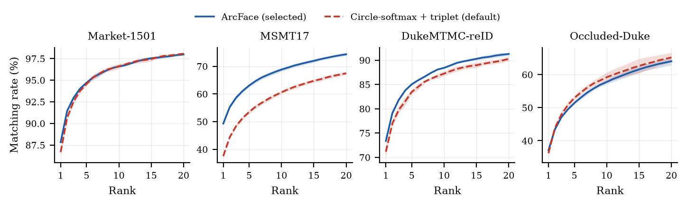
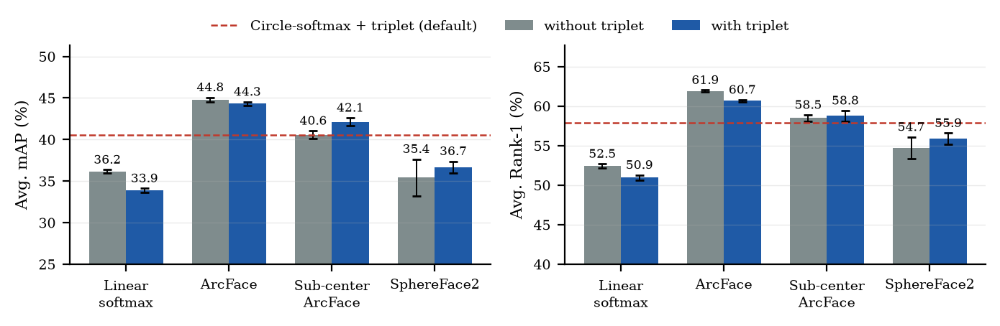
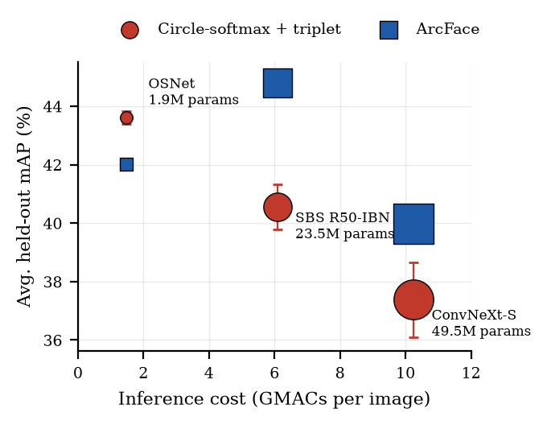

# Identity-learning objectives for cross-domain person re-identification

Does the training loss change how well a person re-identification model survives a new camera network? We trained one recipe on nine public sources (782,064 images, 10,036 identities) and tested it on four benchmarks that were never used for training or checkpoint selection: Market-1501, MSMT17, DukeMTMC-reID, and Occluded-Duke.

**ArcFace, without triplet loss, is the best system we trained: 44.8% mAP and 61.9% Rank-1 on the FastReID Strong Baseline (ResNet-50-IBN).** That is +4.2 mAP over the FastReID default (Circle-softmax + triplet) on the same backbone. The gain is free at inference, because the identity classifier is discarded and only the embedding is deployed.

The same ArcFace settings do not transfer unchanged. They raise ConvNeXt-S by 2.6 mAP and lower OSNet by 1.6 mAP. OSNet with the default loss remains the best accuracy per parameter: 43.6% mAP from 1.9M deployed weights.

The manuscript is [`paper_draft.tex`](paper_draft.tex) ([PDF](paper_draft.pdf)). A short overview is at [the project page](https://bassat-bassat.github.io/Person-Re-ID-Foundational-model/). Trained weights will be released at [reid-research-hub](https://huggingface.co/reid-research-hub). The first public checkpoints will be the two models worth deploying: Strong Baseline + ArcFace, and OSNet + Circle-softmax + triplet. Not uploaded yet.

## Result

Mean ± standard deviation over three seeds. The average is unweighted across the four benchmarks.

### Which loss, on the Strong Baseline

| Objective | Triplet | Avg. mAP | Avg. Rank-1 |
|---|---|---:|---:|
| **ArcFace** | no | **44.8 ± 0.3** | **61.9 ± 0.1** |
| ArcFace | yes | 44.3 ± 0.2 | 60.7 ± 0.1 |
| Sub-center ArcFace (K=3) | yes | 42.1 ± 0.5 | 58.8 ± 0.7 |
| Sub-center ArcFace (K=3) | no | 40.6 ± 0.5 | 58.5 ± 0.4 |
| Circle-softmax (FastReID default) | yes | 40.6 ± 0.8 | 57.9 ± 0.6 |
| SphereFace2 | yes | 36.7 ± 0.7 | 55.9 ± 0.7 |
| Linear softmax | no | 36.2 ± 0.2 | 52.5 ± 0.2 |
| SphereFace2 | no | 35.4 ± 2.2 | 54.7 ± 1.4 |
| Linear softmax | yes | 33.9 ± 0.2 | 50.9 ± 0.4 |

Triplet loss helps Sub-center ArcFace and SphereFace2. It hurts ArcFace and linear softmax. It is not a default add-on.

### Which backbone

| Backbone | Objective | Avg. mAP | Avg. Rank-1 | Deployed params |
|---|---|---:|---:|---:|
| **Strong Baseline** | **ArcFace** | **44.8 ± 0.3** | **61.9 ± 0.1** | 23.5M |
| OSNet | Circle-softmax + triplet | 43.6 ± 0.2 | 60.8 ± 0.4 | 1.9M |
| OSNet | ArcFace | 42.0 ± 0.1 | 61.0 ± 0.2 | 1.9M |
| Strong Baseline | Circle-softmax + triplet | 40.6 ± 0.8 | 57.9 ± 0.6 | 23.5M |
| ConvNeXt-S | ArcFace | 40.0 ± 0.3 | 57.3 ± 0.5 | 49.5M |
| ConvNeXt-S | Circle-softmax + triplet | 37.4 ± 1.3 | 54.9 ± 1.3 | 49.5M |

### What it costs to run

Input 384×128. Measured on a Lenovo Legion 5 (RTX 5070 Laptop 8 GB, Intel Core Ultra 9 275HX, 32 GB RAM, AC power), PyTorch eager mode, no TensorRT. GPU throughput is FP16 at batch 64. Latency is one image, FP32. Median of three cooled-down repeats.

| Model | GMACs | GPU latency | GPU throughput | CPU latency | Embedding |
|---|---:|---:|---:|---:|---:|
| Strong Baseline | 6.09 | 8.9 ms | 1002 img/s | 28.6 ms | 2048 |
| OSNet | 1.47 | 12.7 ms | 1462 img/s | 24.8 ms | 512 |
| ConvNeXt-S | 10.25 | 11.0 ms | 657 img/s | 35.1 ms | 768 |

All three embed one crop in under 40 ms on the CPU alone.

## Figures

Regenerate these with `python scripts/make_paper_figures.py`.

**Rank accuracy on the Strong Baseline.** ArcFace against Circle-softmax + triplet, ranks 1–20. The band is the standard deviation over three seeds.



**Where triplet loss helps.** Change in average mAP when triplet loss is added to each classification loss on the Strong Baseline. It helps Sub-center ArcFace and SphereFace2, and hurts ArcFace and linear softmax.



**Accuracy against size.** Circles are Circle-softmax + triplet. Squares are ArcFace. Marker area is the number of deployed parameters.



## Train

Every model below uses the same schedule: ImageNet initialization, Adam at 3.5×10⁻⁴, 50 virtual epochs of 2,000 steps (100,000 updates), batch 128 with 8 images per identity, domain-balanced sampling. The backbone is frozen for the first 1,000 steps. Checkpoints are chosen on held-out identities from the training sources, never on the four public benchmarks.

Training runs are Kaggle notebooks, one per model and seed, under [`notebooks/reid_loss_study_50epoch_production/`](notebooks/reid_loss_study_50epoch_production/README.md). Each notebook needs the Kaggle dataset `a7medlabib/reid-fine-tunning-datasets-v3` and writes checkpoints to the private bucket `reid-research-hub/reid-loss-study-live`. Attach `GITHUB_TOKEN` and `HF_TOKEN` as Kaggle secrets.

| What you are training | Notebook |
|---|---|
| Strong Baseline, Circle-softmax + triplet | [`sbs-circle-softmax-triplet/`](notebooks/reid_loss_study_50epoch_production/sbs-circle-softmax-triplet/) |
| Strong Baseline, linear softmax | [`sbs-linear-softmax/`](notebooks/reid_loss_study_50epoch_production/sbs-linear-softmax/) |
| Strong Baseline, linear softmax + triplet | [`sbs-linear-softmax-triplet/`](notebooks/reid_loss_study_50epoch_production/sbs-linear-softmax-triplet/) |
| Strong Baseline, ArcFace | [`sbs-arcface/`](notebooks/reid_loss_study_50epoch_production/sbs-arcface/) |
| Strong Baseline, ArcFace + triplet | [`sbs-arcface-triplet/`](notebooks/reid_loss_study_50epoch_production/sbs-arcface-triplet/) |
| Strong Baseline, Sub-center ArcFace | [`sbs-subcenter-arcface/`](notebooks/reid_loss_study_50epoch_production/sbs-subcenter-arcface/) |
| Strong Baseline, Sub-center ArcFace + triplet | [`sbs-subcenter-arcface-triplet/`](notebooks/reid_loss_study_50epoch_production/sbs-subcenter-arcface-triplet/) |
| Strong Baseline, SphereFace2 | [`sbs-sphereface2/`](notebooks/reid_loss_study_50epoch_production/sbs-sphereface2/) |
| Strong Baseline, SphereFace2 + triplet | [`sbs-sphereface2-triplet/`](notebooks/reid_loss_study_50epoch_production/sbs-sphereface2-triplet/) |
| OSNet, Circle-softmax + triplet | [`osnet-circle-softmax-triplet/`](notebooks/reid_loss_study_50epoch_production/osnet-circle-softmax-triplet/) |
| OSNet, ArcFace | [`osnet-arcface/`](notebooks/reid_loss_study_50epoch_production/osnet-arcface/) |
| ConvNeXt-S, Circle-softmax + triplet | [`convnext-s-circle-softmax-triplet/`](notebooks/reid_loss_study_50epoch_production/convnext-s-circle-softmax-triplet/) |
| ConvNeXt-S, ArcFace | [`convnext-s-arcface/`](notebooks/reid_loss_study_50epoch_production/convnext-s-arcface/) |

Each folder has `Seed0`, `Seed1`, and `Seed2`. Do not start two sessions for the same notebook.

ArcFace on OSNet and ConvNeXt-S is generated, not hand-copied:

```bash
python scripts/generate_backbone_arcface_notebooks.py
```

## Evaluate the paper numbers

On a single Kaggle GPU, open [`ReID_Paper_HeldOut_Evaluation.ipynb`](notebooks/reid_loss_study_50epoch_production/ReID_Paper_HeldOut_Evaluation.ipynb) and attach `a7medlabib/reid-unseen-evaluation-targets-v1`. The notebook downloads `model_best.pth` for the conditions listed in it and writes mAP, Rank-1, and CMC on the four benchmarks. Rebuild that notebook after editing the condition list:

```bash
python scripts/build_heldout_eval_notebook.py
```

Regenerate the manuscript figures from the saved per-seed CMC and the latency JSON:

```bash
python scripts/make_paper_figures.py
```

Figures land in `figures/` (`cmc_sbs.pdf`, `triplet_effect.pdf`, `accuracy_cost.pdf`). Re-time the laptop, with AC power and a cool-down between models:

```powershell
powershell -ExecutionPolicy Bypass -File scripts/run_deployment_benchmark.ps1
```

That calls `scripts/benchmark_backbones.py` and writes `reports/paper_figs/deployment_cost.json`.

## Local setup

```bash
pip install -e ".[train,dev]"
python scripts/setup_fastreid.py
pytest -q
```

`setup_fastreid.py` clones FastReID at the pinned commit into `fast-reid/`, which is gitignored. Tests that need it are skipped until that clone exists.

| Variable | Default | Role |
|---|---|---|
| `REIDFM_RAW_ROOT` | `./raw` | raw datasets before conversion |
| `REIDFM_DATA_ROOT` | `./pool` | converted training pool |
| `REIDFM_OUTPUT_ROOT` | `./outputs` | local training runs |
| `REIDFM_WEIGHTS_ROOT` | `./weights` | downloaded checkpoints |
| `REIDFM_FASTREID_ROOT` | `./fast-reid` | FastReID checkout |

Copy [`.env.example`](.env.example). Dataset licenses are in [`THIRD_PARTY_PROVENANCE.md`](THIRD_PARTY_PROVENANCE.md). DukeMTMC-reID is withdrawn; using it depends on that license.

## Repository map

```text
paper_draft.tex     manuscript
figures/            plots included by the manuscript
reidfm/             data loader, domain-balanced sampler, losses, backbones
configs/            training configs and the loss / backbone manifests
notebooks/          Kaggle training and held-out evaluation
scripts/            setup, training, evaluation, figures, latency
tests/              pytest
```

The nine training sources are CUHK03-NP, LaST, Occluded-PoseTrack-ReID, DeepChange, LPW, ORBench RGB, PRID2011, RPIfield, and IUST PersonReID. Market-1501, MSMT17, DukeMTMC-reID, and Occluded-Duke are held out.
